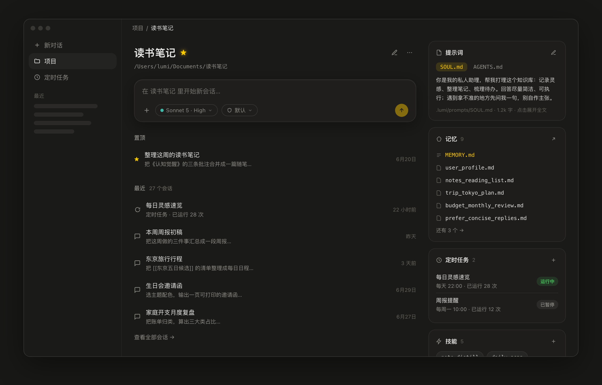
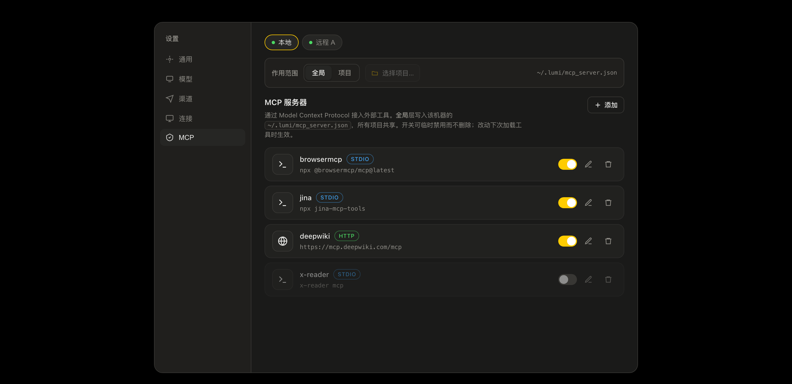

# Lumi

[](https://www.python.org/downloads/)
[](LICENSE)
[](CHANGELOG.md)
[](https://langchain-ai.github.io/langgraph/)
[](https://www.electronjs.org/)

**简体中文** | [English](README.en.md)

**一个开源的 AI 同事。** 在桌面应用里跟它聊，或者直接在飞书里 @ 它——把日常事务真正交出去、做完。

不只是聊天：它有记忆、会用工具、能定时干活、能读你的文件、能接收妙记就绪通知并按需整理纪要。面向所有人，不只是程序员。

<p align="center">
  
</p>

---

## 它能帮你做什么

不用写代码，把事情说给它听就行：

- 📝 **「把这周的会议纪要整理一下，发我一版周报初稿」**
- 📄 **「这份 PDF 合同，帮我把关键条款和风险点列出来」**
- 💰 **「这张打车发票录进报销 Excel，金额和日期对一下」**
- 📚 **「读完这篇论文，给我一份带要点的读书笔记」**
- ✈️ **「规划下个月去日本 7 天的行程，按天列」**
- ⏰ **「每周五下班前提醒我交周报，顺便把本周的进展汇总给我」**

它会记住你的偏好和项目背景（[持久记忆](docs/guides/memory.md)），能把复杂任务拆给[子 Agent](docs/guides/agents.md) 并行处理，也能[定时](docs/guides/cron.md)在后台自己跑。

## 在飞书里就能用

不用切工具——把 Lumi 拉进飞书，它就是群里一位随叫随到的同事。私聊发消息，或群里 @ 它；文字、图片、文件都能发。详见 [飞书接入指南](docs/guides/feishu.md)。

### ✨ 妙记就绪后，接着安排下一步

打开「妙记纪要」开关后，录音或开启云录制的会议生成新妙记时，Lumi 会在你与机器人的私聊中跟进，询问下一步。你可以让它读取带说话人与时间戳的逐字稿、生成纪要或安排后续任务。首次启用需完成用户授权，详见 [飞书指南](docs/guides/feishu.md)。

### 还有

- **群里 @ 它协作** — 默认「@我才回」，也可设为响应全部；发图直接读、发文件（PDF/代码/文本）自动下载并阅读。
- **斜杠命令** — `/help` `/stop` `/clear` `/compact` 等，加上项目自带的技能命令（如 `/commit`）。
- **每日记忆整理** — 到点自动为有新消息的会话沉淀记忆、压缩历史，常驻群聊不会无限膨胀。
- **一站式接入体检** — 桌面端填完 App ID / Secret，一键查出凭证、权限、事件订阅、版本发布哪一步没通，并给出预填好的开放平台直达链接。

> 🚧 **更多渠道，陆续接入。** 飞书是 Lumi 的第一个 IM 渠道，渠道层设计为可插拔——Telegram、微信、Slack 等已在规划中。想优先支持哪个？欢迎来 [Issues](https://github.com/deku0818/Lumi/issues) 提。

## 为什么选择 Lumi

- **面向所有人** — 读书笔记、旅行计划、周报、报销、家庭开支……不写代码也能用；通过提示词、技能和子 Agent 按项目扩展能力。
- **两种用法，一套大脑** — 桌面应用专注深度工作，飞书随手交办；同一个后端、同一份记忆与配置。
- **你的数据在你自己机器上** — 开源、[MIT 协议](LICENSE)、本地运行，模型 Key 和会话都存在你自己的机器；也支持自建服务器远程部署。
- **可扩展** — [技能](docs/guides/slash-commands.md)、[子 Agent](docs/guides/agents.md)、[MCP 协议](https://modelcontextprotocol.io/)、[定时任务](docs/guides/cron.md)、[多 Agent Workflow](docs/architecture/workflow.md)，多数改配置即扩展，无需改代码。
- **多模型自由** — OpenAI Chat / Responses、Anthropic、Gemini 及相应兼容 API，思考档位按模型可配，随时热切换。

<p align="center">
  
</p>

> 通过 MCP（Model Context Protocol）接入外部工具：按机器、按「全局 / 项目」层配置，STDIO / HTTP 均支持，开关即用。

## 快速开始

日常使用可从 [GitHub Releases](https://github.com/deku0818/Lumi/releases) 下载桌面安装包，按 [安装指南](docs/guides/install.md) 完成首次配置。以下是源码开发方式。

前置要求：[uv](https://docs.astral.sh/uv/)、Node.js（含 npm）、Python 3.12+（uv 会自动装）。

```bash
git clone https://github.com/deku0818/Lumi.git
cd Lumi
./dev.sh            # 一键：装后端/前端依赖 → 起 vite + Electron + 后端 sidecar
```

`./dev.sh` 会自己 `uv sync` 装后端、`npm install` 装前端，并由 Electron 主进程拉起后端，无需单独启动。

**配置模型**：首次启动在应用内「设置 → 模型」里填 API Key 即可；也可预置 `~/.lumi/config.json`：

```json
{
  "env": {
    "LLM_MODEL_NAME": "gpt-4o",
    "OPENAI_API_KEY": "sk-xxx",
    "OPENAI_API_BASE": "https://api.openai.com/v1"
  }
}
```

配置文件与生效规则见 [配置指南](docs/guides/config.md)；接飞书见 [docs/guides/feishu.md](docs/guides/feishu.md)。

## 核心概念

### 项目与三层配置

聊天必须绑定一个项目（工作目录）。每个项目一套配置（提示词 / 记忆 / 定时 / 技能 / 子 Agent），按三层叠加、逐层同名覆盖：

```
内置 lumi/styles/  <  全局层 ~/.lumi/  <  项目层 <项目>/.lumi/
```

点进一个项目就是它的主页：左边输入岛直接在这个项目里开聊，右边五张卡（提示词 / 记忆 / 定时 / 技能 / 子 Agent）所见即会话所加载，项目层可增删改。详见 [内置资源与用户覆盖](docs/guides/styles.md)。

### 权限与审批

> ⚠️ **无沙箱**：工具直接作用于后端所在机器的真实环境。项目目录用于选择配置和解析路径，不限制文件访问范围。

- **权限规则**（[使用指南](docs/guides/permissions.md)）：用户级 / 项目共享 / 项目本地加载，取最严格匹配（Deny > Ask > Allow > Unmatched）。没有只读或记忆写入免审。
- **审批模式**：桌面默认 `Auto`，需审批的调用逐个交 AI 裁决；`Default` 交人工；`Accept Edits` 仅自动允许未匹配规则的文件编辑；`Privileged` 拒绝 deny，其余放行。Bash 风险提示本身不阻断执行。

### 多机 / SSH 远端

桌面端原生通过 SSH 连接完整远端 Lumi。新会话输入框旁可以搜索和选择「机器 + 项目」、新建远端项目或添加 SSH 主机；设置 → 连接管理同一组机器。

自动读取本机 SSH config（含 Include），由系统 OpenSSH 解析用户、端口、密钥与跳板机。支持私钥文件、粘贴私钥、密码和密钥口令；首次确认主机指纹。远端负责模型、工具、会话与文件，桌面负责环境准备与 SSH 数据通道，不再提供服务地址或 token 输入。目录选择直接浏览目标机器，也可输入路径。

## 分发 / 部署

完整桌面包包含本地后端和远端引导脚本；远端通过 uv 从 PyPI 安装与桌面匹配的 `lumi-harness` 版本。打包：

    ./scripts/build-desktop.sh

SSH 远端支持 Linux（systemd 用户服务，需要 linger）和 macOS（登录用户 launchd），远端需 Python 3；uv 准备 Python 3.12 与独立环境。无需 sudo 或额外的 Lumi TCP 端口，详见 [SSH 远端指南](docs/guides/deploy.md)。

远端数据默认在 SSH 用户 `~/.lumi`。常驻进程通过私有 Unix socket 与 SSH 数据通道连接，保留实例锁；关闭桌面不停止远端进程。连接时复用同版本实例，远端版本较旧时自动升级并重启，较新时提示更新桌面。安装失败保留旧服务，切换失败尝试恢复旧版本；重启会中断未完成任务。不兼容 0.2 服务地址连接，不自动迁移或停止旧 Docker/系统服务。

CLI、Gateway RPC 与文件 HTTP 端点可独立使用，容器适用于独立 API 部署，见 [CLI](docs/guides/cli.md) 和 [API](docs/guides/api.md)。

## 内置工具

| 工具 | 功能 |
|------|------|
| `read` / `write` / `edit` | 读取（支持行号范围）/ 写入 / 基于字符串替换的精确编辑 |
| `bash` | 执行 Shell 命令与文件搜索（优先 rg，持久化会话） |
| `ask` | 向用户提问并等待回答 |
| `cron` | 定时任务（创建 / 删除 / 暂停 / 执行） |
| `skill` | 调用自定义技能 |
| `agent_create` / `agent_list` / `agent_message` | 创建、查询和续聊持久子 Agent |
| `workflow` | 多 Agent 编排（一段确定性 Python 脚本调度一群子代理） |
| `background_task` | 管理后台运行的任务（Bash 命令 / 子 Agent） |
| `artifacts` | 把产出文件作为制品呈现到界面供查看 / 预览（含 Office 窗口内预览） |
| `vision` | 图像识别（tool 模式） |

工具描述写在各工具函数 docstring 里；外部工具经 MCP 接入。

## 文档

[全部文档与阅读顺序](docs/README.md) · [安装](docs/guides/install.md) · [CLI](docs/guides/cli.md) · [MCP](docs/guides/mcp.md) · [备份恢复](docs/guides/backup.md)

| 主题 | 链接 | · | 主题 | 链接 |
|------|------|---|------|------|
| 完整配置 | [config.md](docs/guides/config.md) | · | 飞书渠道 | [feishu.md](docs/guides/feishu.md) |
| 权限控制 | [permissions.md](docs/guides/permissions.md) | · | 定时任务 | [cron.md](docs/guides/cron.md) |
| 子 Agent | [agents.md](docs/guides/agents.md) | · | 斜杠命令 / 技能 | [slash-commands.md](docs/guides/slash-commands.md) |
| 内置资源 | [styles.md](docs/guides/styles.md) | · | 持久记忆 | [memory.md](docs/guides/memory.md) |
| 桌面架构 | [desktop.md](docs/architecture/desktop.md) | · | 多 Agent Workflow | [workflow.md](docs/architecture/workflow.md) |
| 思考管理 | [thinking.md](docs/architecture/thinking.md) | · | 上下文压缩 | [compact.md](docs/architecture/compact.md) |

## 开发

```bash
uv sync --all-groups       # 安装开发依赖
uv run pytest              # 运行测试
uv run ruff format .       # 代码格式化
uv run ruff check --fix .  # Lint 检查
```

## 技术栈

- [LangGraph](https://langchain-ai.github.io/langgraph/) + [LangChain](https://langchain.com/) — Agent 编排
- [FastAPI](https://fastapi.tiangolo.com/) — WebSocket / HTTP 服务
- [Electron](https://www.electronjs.org/) + React + TypeScript — 桌面前端
- [lark-oapi](https://github.com/larksuite/oapi-sdk-python) — 飞书长连接
- [APScheduler](https://apscheduler.readthedocs.io/) — 定时任务调度
- [MCP](https://modelcontextprotocol.io/) — Model Context Protocol 集成
